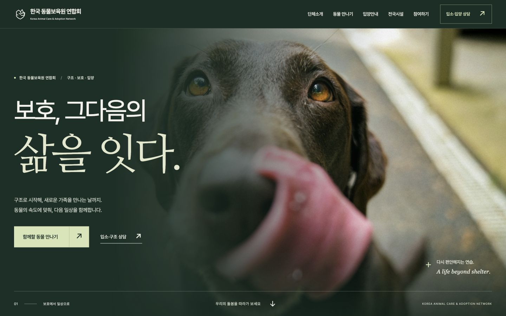

# 한국 동물보육원 연합회 웹페이지 리뉴얼

구조·보호·입양을 처음 접하는 사람이 기관을 이해하고, 필요한 안내로 바로 이동할 수 있도록 설계한 동물보호센터 소개 상세페이지입니다. 채용 과제용 비공식 시안이며, 실제 운영 서비스가 아닙니다.

현재 시안의 중심은 **‘기다리는 시간도 돌봄이다’**입니다. 동물의 속도에 맞춘 보호를 큰 사진, 명조체의 서술, 사용자가 직접 넘기는 돌봄 과정으로 표현했습니다.

## 화면 미리보기



[실제 Hero 모션 미리보기](docs/qa/hero-motion.gif) · [제출 ZIP 다운로드](https://github.com/catmaker/animal-center-renewal/releases/download/v1.0.0/animal-center-renewal.zip)

## 실행 방법

1. ZIP 전체를 압축 해제합니다.
2. `animal-center-renewal/index.html`을 Chrome 또는 Safari로 엽니다.
3. 설치, 빌드, 서버, 인터넷 연결 없이 페이지와 내부 기능을 사용할 수 있습니다.

ZIP 내부 미리보기에서 HTML 하나만 열거나 `index.html`만 다른 폴더로 옮기면 상대경로가 끊어집니다. 폴더 전체를 함께 유지해 주세요. 전화 연결은 통화 가능한 기기, 공식 사이트·카카오톡·SNS 연결은 인터넷이 필요합니다. 로컬 페이지는 상담 안내를 제공하며 신청이나 개인정보를 접수하지 않습니다.

## 프로젝트 소개와 확인 자료

- [실제 운영 사이트](https://kanimal.org/)
- [채용 공고](https://www.jobkorea.co.kr/Recruit/GI_Read/49932691)
- 확인일: **2026년 11월 3일, 한국 시간**

원본 사이트를 데스크톱과 390px 브라우저 화면으로 열고, 메뉴·배너·서비스 안내·지역 지부·상담·콘텐츠·푸터를 확인했습니다. 공고는 잡코리아 브라우저 페이지와 상세요강 iframe에서 직접 확인했습니다. 도구의 웹 문서 읽기에서는 공고 접근에 실패했지만 브라우저에서는 과제 원문을 확인했습니다.

공고의 핵심은 반응형 상세페이지 제작, 사용한 모든 소스 포함, 외부 라이브러리 사용 내용 기재, 하나의 폴더로 ZIP 제출, 별도 추가 파일 없이 실행입니다. 사용자 요청의 더 엄격한 `file://` 직접 실행 조건까지 반영했습니다.

## 기존 서비스 분석

### 1. 서비스 범위와 첫 방문 목적이 함께 노출됨

원본 상단에는 단체 소개, 입소·입양, 동물출동, 드론출동, 케어서비스, 교육·파트너, 인재채용, 지원센터 메뉴가 있습니다. 기능이 풍부한 대신 보호센터를 처음 알아보는 사람에게는 선택지가 많습니다. 이번 소개 페이지에서는 다섯 개의 주요 내비게이션과 별도 상담 버튼으로 정리했습니다.

### 2. 다른 목적의 기능이 탐색에 섞임

원본은 회원·장바구니·마이쇼핑과 동물보호 안내를 함께 제공합니다. 모바일 하단에도 검색·홈·장바구니·마이페이지 성격의 탐색이 보입니다. 소개 페이지에서는 입양 탐색과 입소·구조 상담, 시설 찾기를 우선했습니다.

### 3. 이미지 배너와 여러 콘텐츠의 정보 위계

첫 배너, 서비스 바로가기, 콘텐츠 슬라이드, 영상이 이어집니다. 원본 배너의 시각 메시지를 의미 있는 HTML 제목·본문·버튼으로 분리해 화면 크기, 이미지 로드, 보조기술 사용 여부에 따라 메시지를 읽을 수 있게 했습니다. 원본의 배너 로드 상태는 관찰 시점마다 달랐으므로 이를 상시 장애로 단정하지 않았습니다.

### 4. 시설 정보의 양

공식 홈에는 ‘전국 77개 지부’와 지역별 시설·상담 연결이 안내됩니다. 이 강점을 유지하면서 지역 탭으로 관련 시설만 보여주고, 지부명·권역·상담 행동을 같은 순서로 배치했습니다. 77개는 공식 사이트의 표기이지, 이번 프로젝트가 운영 현황을 독립 검증한 수치는 아닙니다.

### 5. 행동까지의 단계

원본에도 입양 배너와 상담 바로가기가 있어 모든 행동이 여러 단계를 요구하는 것은 아닙니다. 다만 메뉴로 시작할 경우 대분류와 하위 항목을 판단해야 합니다. 새 페이지는 첫 화면의 입양 버튼과 상담 버튼, 바로 아래의 네 가지 행동 목록으로 시작점을 고정했습니다. 클릭 수 개선은 설계상 변화이며 실제 사용자 실험으로 측정한 성과는 아닙니다.

## 개선 방향

- **핵심 행동 중심 IA:** 입양 탐색 / 입소·구조 상담 / 가까운 시설 찾기를 우선합니다.
- **이해 → 신뢰 → 동물 확인 → 과정 이해 → 행동:** 기관 설명 뒤에 돌봄 방식, 동물, 입양 절차, 시설·참여가 이어집니다.
- **구체적인 한국어:** 추상적인 미션 선언 대신 실제로 안내하는 일과 이용자의 다음 행동을 씁니다.
- **사진 중심 탐색:** 8마리의 종류·나이·성별·지역·특징을 카드 아래 같은 순서로 제공합니다.
- **모바일의 우선순위 유지:** 상담은 헤더에 남기고, 메뉴는 펼침형으로, 보호동물은 2열로 재배치합니다.
- **정직한 연결:** 동물과 이야기는 시연용으로 표시하고, 실제 공고와 상담은 공식 채널로 연결합니다.

## 정보구조

Header → Hero → 빠른 행동 → 단체 소개 → 구조·보호·회복·입양 → 보호동물 → 회복 이야기 → 입양 절차 → 전국 시설 → 활동 가치 → 공식 활동 콘텐츠 → 봉사·협력 → FAQ → 마지막 상담 CTA → Footer.

## 사용 기술과 외부 자산

| 구분 | 사용 내용 |
| --- | --- |
| 마크업 | HTML5, 시맨틱 랜드마크, 단일 H1 |
| 스타일 | CSS3, Custom Properties, Grid/Flex, 미디어 쿼리, `clamp()` |
| 동작 | Vanilla JavaScript, 일반 `defer` 스크립트, IntersectionObserver, 네이티브 `dialog` |
| 외부 JS/CSS 라이브러리 | 없음 |
| 프레임워크 / 패키지 설치 / 빌드 | 없음 |
| 사진 | Unsplash 실제 사진 17장, 전부 로컬 저장 |
| 폰트 | Pretendard Variable + 나눔명조 기반 Care Myeongjo 사용 글자 서브셋, SIL OFL 1.1, 로컬 저장 |
| 로고·지도·화살표 | 시안용 직접 작성 SVG 및 텍스트. 공식 로고가 아님 |
| API / CDN / 추적 / 쿠키 | 사용하지 않음 |

사진 출처와 라이선스는 [ASSET_LICENSES.md](ASSET_LICENSES.md), 원본 이미지 식별자는 [docs/photo-sources.json](docs/photo-sources.json)에 있습니다. 폰트 라이선스 전문은 `assets/fonts/OFL.txt`와 `assets/fonts/NanumMyeongjo-OFL.txt`에 포함했습니다. 나눔명조 파생 서브셋은 예약 글꼴 이름을 피하도록 내부 패밀리 이름을 Care Myeongjo로 변경했습니다. 제작 중 사용한 Python 이미지/폰트 도구는 제출 페이지의 실행 의존성이 아닙니다.

## 구현 기능

- 스크롤 시 헤더 배경·경계선 변경, 현재 주요 섹션 표시
- 네이티브 앵커 이동, 이동한 본문 영역으로 키보드 초점 전달
- 모바일 메뉴 열기/닫기, 외부 클릭·Escape·메뉴 선택 후 닫기
- 전체 8 / 강아지 3 / 고양이 3 / 기타 2 필터, 결과 수 음성 안내
- 8개 동물 상세 프로필 팝업
- 8개 지역 탭, Arrow / Home / End 키 이동, 시설 목록 갱신
- 6개 FAQ 독립 펼침·닫힘, Enter·Space 동작
- 목적별 상담 안내, 실제 공식 전화·카카오톡 연결
- 가상 회복 이야기와 입양 상담으로 이어지는 팝업
- 팝업 Escape·닫기·바깥 클릭, Tab 초점 순환과 닫은 뒤 초점 복귀
- Hero 문장 마스킹 1.1초 / 사진 1.8초 줌 정착 / 미세한 스크롤 시차
- 데스크톱에서 사진을 고정하고 스크롤 위치에 맞춰 구조·보호·회복·입양 4단계 크로스페이드
- 모바일에서 같은 돌봄 내용을 4개 버튼으로 직접 선택
- 읽기 진행선, 소개 문장의 밑줄 드로잉, 동물 사진의 순차 노출과 필터 결과 전환
- FAQ 높이 전환 240–360ms, 지역 본문 전환 380ms, 팝업 진입 350ms
- 사진 hover 1.035배, 모든 모션은 reduced-motion 분기 적용
- 화면 이동 감소 설정 반영, 맨 위로 이동

`js/data.js`에는 시연 프로필과 시설 데이터를, `js/main.js`에는 동작을 분리했습니다. 기본 동물 카드와 서울 시설은 HTML에도 있어 데이터 요청 실패로 빈 페이지가 되지 않습니다. JavaScript가 꺼진 경우 전체 동물은 읽을 수 있고 고객센터는 푸터와 안내문에 남습니다. 필터·탭·팝업은 JavaScript가 필요합니다.

## 디자인 시스템과 판단

- Forest `#182F26`: 첫 화면과 돌봄·참여 구간의 몰입감. Cream `#F5F3EC`: 정보를 차분하게 읽는 바탕.
- Pale green `#D8E4B5`: 주요 행동과 현재 단계. Orange `#BD603E`: 포커스·소개 문장의 밑줄.
- 서술은 로컬 명조체, 탐색과 UI 정보는 Pretendard로 역할을 분리합니다.
- Hero는 프레임 없는 사진 한 장과 큰 두 줄 제목으로 구성합니다. 사진 위 명암 처리는 문자 대비를 위한 제한적인 오버레이입니다.
- 보호동물은 4:5 세로 사진과 엇갈린 배치로 개체를 천천히 보게 하고, 기본 정보의 순서는 고정합니다. 필터를 선택하면 일반 그리드로 정리됩니다.
- 최대 콘텐츠 1200px, Hero 텍스트 1360px. 주요 섹션 간격 136 / 112 / 88px.
- Hero 제목은 데스크톱 약 72px + 명조체 121px, 모바일 약 40px + 명조체 67px. 읽는 본문은 화면에 따라 13–16px, 중요 모바일 본문은 14px 이상입니다.
- 둥근 카드와 장식용 작은 사진을 없애고 사진·선·타이포그래피로 섹션의 성격을 나눴습니다.

모션은 콘텐츠의 관계를 설명합니다. 첫 화면은 시선을 정돈한 뒤 멈추고, 돌봄의 사진과 진행선은 실제 읽는 위치를 따릅니다. 페이지를 자동으로 넘기거나 스크롤을 가로채지 않습니다. 모바일은 긴 고정 스크롤 대신 직접 선택하는 형태입니다.

## 접근성과 성능

`lang="ko"`, 본문 바로가기, 제목 단계, 의미 있는 대체 텍스트, 내비게이션 이름, 펼침 상태와 연결 대상, 필터 `aria-pressed`, 탭 선택 상태와 로빙 tabindex를 적용했습니다. 클릭 가능한 버튼·링크의 터치 영역은 44px 이상을 기준으로 작성하고 검수했습니다. 키보드 포커스에는 3px 주황색 외곽선을 제공합니다.

주요 본문·보조문구의 대비를 확인했고, 초안의 작은 녹색 문자와 큰 단계 번호 색을 더 진하게 수정했습니다. 전체 보조기술 조합에 대한 인증이나 WCAG 적합성 인증을 의미하지는 않습니다.

Hero 사진은 우선 로드하며 아래 이미지는 lazy load합니다. 이미지 크기와 사진 비율을 지정해 공간을 예약했습니다. 본문 폰트는 약 **95KB**, 명조체는 약 **77KB**의 서브셋으로 줄였으며, 폰트 실패 시 시스템 폰트로 표시됩니다. 전역 스크롤 이벤트는 passive + requestAnimationFrame으로 처리하고 나타남 관찰은 표시 후 해제합니다.

**Lighthouse 점수는 실행·측정하지 않았으므로 목표 점수 달성을 주장하지 않습니다.** 실제 배포 속도, 저사양 기기, 저속 네트워크, 실제 iOS/Android는 추가 확인 대상입니다.

## QA 결과

2026.11.03 Chrome에서 다음 뷰포트를 직접 확인했습니다.

| 화면 | 크기 | 가로 넘침 / 이미지 경로 |
| --- | --- | --- |
| Desktop | 1440 × 900 | 이상 없음 |
| Desktop | 1280 × 800 | 이상 없음 |
| Tablet | 1024 × 768 | 이상 없음 |
| Tablet | 768 × 1024 | 이상 없음 |
| Mobile | 430 × 932 | 이상 없음 |
| Mobile | 390 × 844 | 이상 없음 |
| Mobile | 375 × 812 | 이상 없음 |

Chrome에서 필터 네 가지, 지역 여덟 개, FAQ 여섯 개, 메뉴, 프로필, 상담, 초점 복귀 및 순환을 확인했습니다. 수집한 Chrome 오류·경고 로그는 0건입니다. 현재 수정본은 Safari의 로컬 HTTP에서 한글 명조체·사진·레이아웃 렌더링을 확인했습니다. 이전 버전에서의 Safari 파일 직접 실행 확인과 현재 수정본의 검수는 구분합니다. 현재 수정본의 `file://` 직접 실행은 도구 정책상 미검증이며, 정적 경로 검사와 로컬 HTTP 실행으로 확인했습니다. Safari의 모든 뷰포트에 대해 동일한 자동 검사를 실행한 것은 아닙니다.

자세한 검수 범위·한계·재현 방법은 [docs/QA_REPORT.md](docs/QA_REPORT.md)에 있습니다. 화면 캡처와 기계 판독 가능한 결과는 `docs/qa/`에 포함했습니다.

## 사실과 시연 데이터의 경계

- 8마리의 이름·나이·성별·지역·특징, 보리의 회복 이야기는 **모두 가상**입니다.
- 사진 속 동물은 해당 기관의 실제 보호동물 또는 이야기의 당사자임을 뜻하지 않습니다.
- 활동 미리보기는 자체 작성 안내 제목과 예시 사진입니다. 실제 기사의 재현이 아닙니다.
- 지부명은 공식 홈의 일부 안내를 옮겼으며 상세 주소·개별 휴대전화는 수집하지 않았습니다. 지도는 위치 개념도입니다.
- 회사·사업장·대표전화·이메일·운영시간은 공식 사이트 푸터의 확인 당시 정보를 사용했습니다.
- 입양 조건, 비용, 봉사 모집, 후원 방식, 방문 가능 여부를 임의로 확정하지 않습니다.
- 신청 접수·결제·회원·백엔드는 범위에 포함되지 않습니다.

## 파일 구조와 제출

```text
animal-center-renewal/
├── index.html
├── css/
│   ├── reset.css
│   ├── variables.css
│   ├── style.css
│   └── responsive.css
├── js/
│   ├── data.js
│   └── main.js
├── assets/
│   ├── images/ (hero, care, animals, story, activity)
│   ├── icons/favicon.svg
│   └── fonts/ (서브셋 WOFF2 2개, 라이선스 2개)
├── README.md
├── DESIGN_NOTES.md
├── ASSET_LICENSES.md
└── docs/
    ├── QA_REPORT.md
    ├── photo-sources.json
    ├── verify_submission.py
    └── qa/ (캡처와 검수 결과)
```

제출은 상위 폴더의 `animal-center-renewal.zip` **한 개**입니다. 해당 ZIP에는 위 폴더 전체가 들어 있습니다. ZIP은 최종 소스에서 생성하고 별도 임시 디렉터리에 다시 풀어 원본과의 파일 일치·경로를 검증했습니다. 실제 페이지 동작은 원본의 로컬 HTTP 실행으로 확인했습니다. 이전 버전의 Safari 원본 파일 직접 실행은 확인했으나 Chrome 자동화의 보안 정책이 해제본 `file://` 실행을 차단해 해당 방식의 검증은 완료하지 못했습니다. 개인정보가 담긴 작업 폴더의 다른 파일은 포함하지 않았습니다.

정적 검수 재실행: Python 3이 있다면 폴더 안에서 `python3 docs/verify_submission.py`를 실행할 수 있습니다. 이 검수 도구는 선택사항이며 웹페이지 실행에는 필요하지 않습니다.

## 면접에서 설명할 핵심 5가지

1. **기능을 줄인 이유:** 기존 서비스의 폭넓은 기능에서 소개 페이지의 주목적에 맞는 입양·상담·시설만 먼저 드러냈습니다.
2. **디자인을 결정한 기준:** 동정심을 자극하기보다 회복과 일상을 보여주는 사진, 명확한 제목, 서로 다른 편집 구도로 신뢰와 따뜻함을 조절했습니다.
3. **기술을 선택한 이유:** 평가자가 ZIP을 풀고 바로 열 수 있어야 하므로 ES module·fetch·빌드 의존성을 배제했습니다.
4. **접근성은 실제 동작으로 검증:** 상태 속성뿐 아니라 Tab 순환, Escape, 초점 복귀, 지역 탭 키보드 이동까지 확인하고 수정했습니다.
5. **서비스 운영을 고려한 경계:** 검증된 기관 정보, 가상 데이터, 공식 채널 연결을 구분하고 가짜 성과·신청 완료를 만들지 않았습니다.
