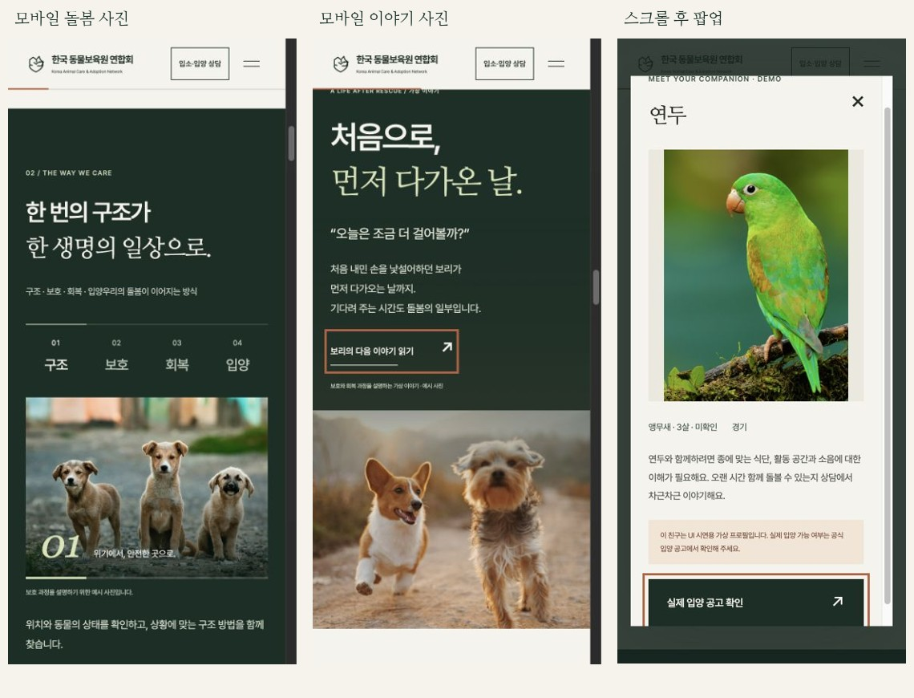

# QA 기록 · v1.1.2

## 추가 검수 · 2026.11.04

푸터에 공식 서비스 바로가기 7개를 추가했습니다. 1440×900, 1280×800, 1024×768, 768×1024, 430×932, 390×844, 375×667, 320×760, 844×390에서 해당 영역을 확인했습니다. 링크 겹침·가로 넘침 없이 모든 링크의 조작 높이가 48px 이상입니다.

공식 주소 7개를 확인했고, 각 링크의 새 창·noopener/noreferrer·보조기술 안내를 확인했습니다. Tab·Shift+Tab 이동 순서와 드론출동 링크의 Enter 새 창 열기를 실제 브라우저에서 확인했습니다. 수집한 콘솔 오류·경고는 0건입니다. 이번 변경의 결과는 `qa/footer-services-results.json`, 화면은 `qa/footer-services-desktop.jpg`와 `qa/footer-services-mobile.jpg`에 있습니다.

아래 전체 검수 기록은 v1.1.1에서 수행한 범위이며 이번 변경에서는 푸터를 중심으로 확인했습니다.

## 전체 검수 · v1.1.1

검수일: 2026.11.03 · macOS Chrome 중심, 로컬 HTTP 실행

전체 페이지를 처음부터 푸터까지 스크롤하며 이미지 로드·나타남 효과·레이아웃을 확인했습니다. 아래 문제를 수정하고 명시한 범위에서 재검수를 통과했습니다.

## 발견한 문제와 수정

| 발견 | 수정 |
| --- | --- |
| 태블릿 돌봄 사진에서 양옆 강아지 얼굴이 잘림 | 사진 영역을 모든 화면에서 4:3으로 정리하고 사진별 초점 지정 |
| 모바일 회복 이야기에서 왼쪽 강아지 얼굴이 잘림 | 본문 아래에 원본 14:11 비율의 사진을 배치 |
| 율무 원본 파일이 정사각형으로 잘려 머리 위 여백이 부족함 | 1000×1325 원본 비율 파일로 교체하고 실제 이미지 크기 반영 |
| 팝업을 아래로 스크롤하면 닫기 버튼이 영역 밖으로 나감 | 별도의 고정 도구 영역으로 닫기 버튼을 스크롤 안에 유지 |
| 모바일 맨 위 버튼이 본문을 가림 | 모바일에서는 헤더 로고로 맨 위 이동 제공 |
| 이전 스타일·이미지가 캐시에 남음 | CSS·JS·변경 이미지 URL에 내용 기반 버전 적용 |

나비와 활동 사진의 얼굴 초점도 조정했고, 앵무새는 목록에서도 전체 사진을 표시합니다. 상세 프로필 8마리는 `contain`으로 원본 전체를 표시합니다. 배경·일반 카드 사진은 채움 비율에 따른 크롭을 사용하며 주피사체의 얼굴 구도를 확인했습니다.

## 화면 크기와 이미지

| 분류 | Chrome 뷰포트 |
| --- | --- |
| 데스크톱 | 1440×900, 1280×800, 1024×768 |
| 태블릿 | 768×1024 |
| 모바일 세로 | 430×932, 390×844, 375×667, 320×760 |
| 모바일 가로 | 844×390 |

9개 크기에서 전체 스크롤을 완료했습니다. 각 크기에서 사진 17장 모두 로드되어 총 153건을 확인했습니다. 깨진 이미지, 실제 이미지와 HTML 크기 속성의 불일치, 문서 가로 넘침, 제목·본문 가로 넘침, 44px 미만의 버튼·링크 조작 영역은 검출되지 않았습니다. 숨은 이미지·장식 화살표는 독립 조작 영역으로 계산하지 않습니다.

`qa/final-responsive-results.json`에 크기별 결과를, `qa/full-page-1440.jpg`와 `qa/full-page-mobile-390.jpg`에 전체 화면을 기록했습니다.

## 기능과 키보드

총 114건의 기능·상세 프로필 케이스를 확인했습니다.

| 항목 | 확인 건수·내용 |
| --- | --- |
| 돌봄 과정 | PC·모바일 8건, 네 단계의 버튼·사진·설명 일치 |
| 동물 필터 | 8건, 강아지 3 / 고양이 3 / 기타 2 / 전체 8 |
| FAQ | 12건, Enter 열기·Space 닫기, 종료 후 hidden 확인 |
| 지역 시설 | 16건, 지도 강조·탭·목록·소개 시설 수 일치 |
| 상담 | 14건, 7종 안내의 열기·닫기·화면 내 표시 |
| 모바일·태블릿 메뉴 | 16건, Escape, 본문 이동, 상담 팝업 전환, Tab으로 벗어날 때 닫기 |
| 상세 프로필 | 40건, 8마리 × 5개 크기(1440×900 / 768×1024 / 390×844 / 375×667 / 844×390) |

40개 상세 케이스에서 사진 전체 표시, 최초 화면 내 이미지 배치, 스크롤 후 닫기 버튼 표시, Tab·Shift+Tab 순환, Escape 닫기, 원래 동물 버튼으로 초점 복귀를 확인했습니다. 율무 사진은 변경한 1000×1325 크기로 실제 로드되는 것을 재확인했습니다.

최종 브라우저 실행에서 수집한 콘솔 오류·경고는 0건입니다. 기존 지도 영역 클릭·방향키 결과는 `qa/interactive-map-results.json`에 있습니다. 이번 전체 검수 요약은 `qa/final-audit-results.json`에 기록했습니다.

## 정적 구조와 ZIP

JavaScript 문법, 상대경로 자원, 중복 ID, ARIA 연결 대상, 사진·폰트 포함 여부를 검사했습니다. 이미지 실제 크기, 자원 버전과 파일 해시도 일치했습니다. ZIP 재해제 후 모든 포함 파일의 SHA-256 일치와 제출 구조 검사 통과를 확인했습니다.

## 검수 한계

모바일 확인은 Chrome 뷰포트 검수이며 실제 iOS·Android 기기 검수가 아닙니다. macOS Safari에서는 현재 HTTP 페이지와 앵무새 팝업 열림을 확인했으나 전체 상호작용·스크롤 후 닫기 검수는 완료하지 못했습니다.

최종 버전의 `file://` 직접 실행, Lighthouse 성능 점수, 스크린리더 사용성 평가는 미검증입니다. 폴더 전체를 해제한 뒤 `index.html`을 여는 수동 확인이 남아 있습니다. 실행 구조는 로컬 상대경로와 일반 defer 스크립트이며 필수 외부 JS·CSS·API 호출은 없습니다. 동작 감소 설정 대응은 CSS·JS에 적용했으며 실기기 접근성 인증을 수행한 것은 아닙니다.
